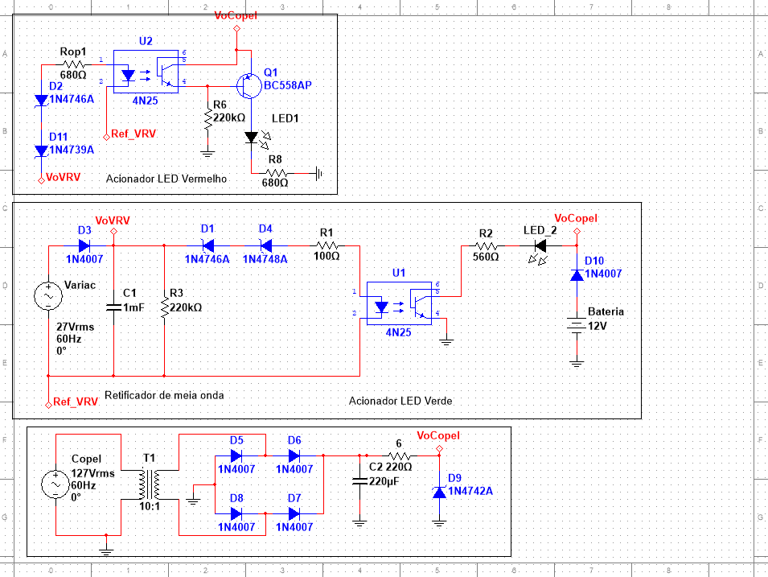
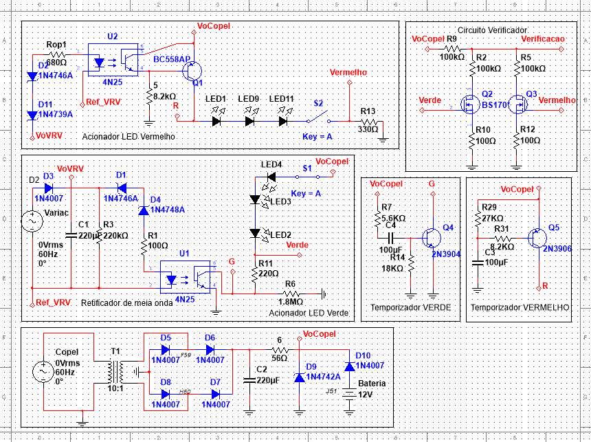

# Doglight, monitor de tensão para aerogeradores

Circuito analógico que monitora a tensão de saída de um aerogerador e sinaliza se ela está normal ou em falha. O projeto foi feito em **duas partes**, na disciplina de Eletrônica Analógica I do curso de Engenharia Eletrônica da UTFPR, em 2019, por uma equipe de três integrantes.

- **Parte 1.** Monitor de tensão com um LED verde para tensão normal e um LED vermelho para falha, isolamento galvânico por optoacopladores e alimentação pela rede com bateria de reserva.
- **Parte 2.** Os LEDs viraram lâmpadas feitas com fita de LED, e entraram um teste automático das lâmpadas ao ligar e um sinal de diagnóstico de LEDs queimados. Nesta parte a regra era usar só **transistores**, sem amplificador operacional nem outro circuito integrado.

O arquivo de simulação deste repositório é do **circuito final**, que reúne as duas partes. O README também mostra o esquemático da Parte 1, para comparar.

> **English:** analog wind-turbine voltage monitor built in two stages by a three-person team (Analog Electronics I course, UTFPR, 2019). Stage 1: optocoupler-isolated voltage sensing with Zener thresholds, green and red indicator LEDs, and a mains supply with 12 V battery backup. Stage 2, using discrete transistors only: lamps made from LED strips, a 3-second lamp self-test at power-up and a DC output that indicates failed LED segments. This repository holds the final circuit, with both stages.

*Teste do circuito final no laboratório. Ao ligar, as duas lâmpadas acendem juntas por cerca de 3 segundos, no teste automático. Com a tensão baixa, só a vermelha fica acesa. Entre os dois limites nenhuma acende, e na tensão normal acende a verde. A tensão do gerador é simulada por um autotransformador variável (Varivolt) e medida no multímetro. Alguns trechos estão acelerados.*

## Requisitos

### Parte 1: monitor de tensão

| Item | Especificação (equipe 11) |
|---|---|
| Tensão normal do gerador | 42 V de pico (30 Vrms), LED verde |
| Tensão de falha | 28 V de pico (20 Vrms), LED vermelho |
| Alimentação | Rede elétrica, com bateria de 12 V que só assume quando a rede falta |
| Escala | Viável para monitorar três aerogeradores ao mesmo tempo |
| Custo | Baixo, para um lote de 10 mil unidades |

### Parte 2: lâmpadas, diagnóstico e teste de fábrica

| Item | Especificação |
|---|---|
| Sinalização | Lâmpadas feitas com fita de LED branca, adaptadas para verde e vermelho |
| Diagnóstico | Saída de tensão contínua que muda de valor conforme grupos de 3 LEDs queimam |
| Teste de fábrica | Ao energizar, pela rede ou pela bateria, as duas lâmpadas acendem por 3 segundos |
| Componentes | Só transistores, sem amplificador operacional nem outro circuito integrado |

## Como o circuito funciona

### Parte 1

*Circuito da Parte 1 no Multisim. De cima para baixo ficam o acionador do LED vermelho, o retificador com o acionador do LED verde e a fonte.*

**Fonte com bateria de reserva.** A rede passa por um transformador 10:1, uma ponte de diodos 1N4007 e um capacitor de filtro de 220 µF. Um diodo zener 1N4742A (12 V) regula a tensão do circuito. A bateria de 12 V entra por um diodo 1N4007, de forma que só alimenta o circuito quando a rede cai.

**Leitura do gerador.** Um retificador de meia onda com capacitor transforma a tensão alternada do gerador numa tensão contínua proporcional ao pico.

**Detecção por zeners e isolamento galvânico.** Cada sinal tem uma cadeia de diodos zener em série que define o limite de tensão. Só quando a tensão do gerador passa desse limite a corrente acende o LED interno de um optoacoplador **4N25**. Assim o lado do gerador fica eletricamente isolado do lado da sinalização.
- **Verde.** Zeners 1N4746A (18 V) e 1N4748A (22 V) em série, para a tensão normal.
- **Vermelho.** Zeners 1N4746A (18 V) e 1N4739A (9,1 V) em série. Abaixo desse limite o optoacoplador para de conduzir, e um transistor BC558 aciona o sinal vermelho.

### Parte 2

*Circuito final, com as duas partes. À esquerda, de cima para baixo, ficam o acionador da lâmpada vermelha, o retificador com o acionador da lâmpada verde e a fonte com bateria. À direita ficam o circuito verificador e os temporizadores do teste automático.*

**Lâmpadas de LED.** Os LEDs da primeira parte foram trocados por segmentos da fita de LED branca, com 3 LEDs em série por segmento, dentro de cúpulas verde e vermelha.

**Teste automático ao ligar.** Dois temporizadores RC com transistores, um 2N3904 para a lâmpada verde e um 2N3906 para a vermelha, com capacitores de 100 µF, mantêm as duas lâmpadas acesas por cerca de 3 segundos depois que o circuito é energizado.

**Verificador de LEDs.** Um circuito com MOSFETs BS170 gera uma tensão contínua de saída que muda de valor conforme segmentos de LEDs deixam de funcionar.

## Arquivos

| Caminho | Conteúdo |
|---|---|
| `simulacao/doglight.ms14` | Circuito final completo para simulação no NI Multisim 14 |
| `docs/` | Esquemáticos das duas partes e GIF do teste |

## O que eu faria diferente hoje

- **Placa de circuito impresso.** O circuito foi validado na protoboard. Para um lote de 10 mil unidades, o próximo passo seria uma PCB, que também reduz mau contato e ruído.
- **Ajuste dos limites.** Os limites dependem da tolerância dos zeners, que costuma ser de 5%. Eu acrescentaria um ajuste fino, como um trimpot, para calibrar cada unidade.
- **Três aerogeradores.** O enunciado pedia que o circuito fosse viável para monitorar três geradores. A fonte poderia ser compartilhada, repetindo só o estágio de leitura e os optoacopladores para cada gerador.

---

Projeto desenvolvido em equipe. Repositório mantido por **Isadora Fernanda Zappe Schmidt** · [LinkedIn](https://www.linkedin.com/in/isadora-fernanda)
