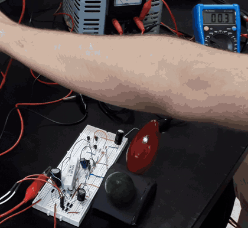
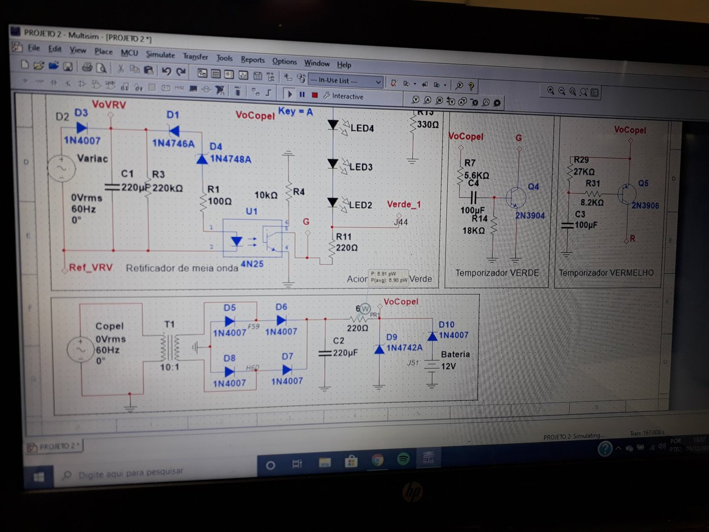
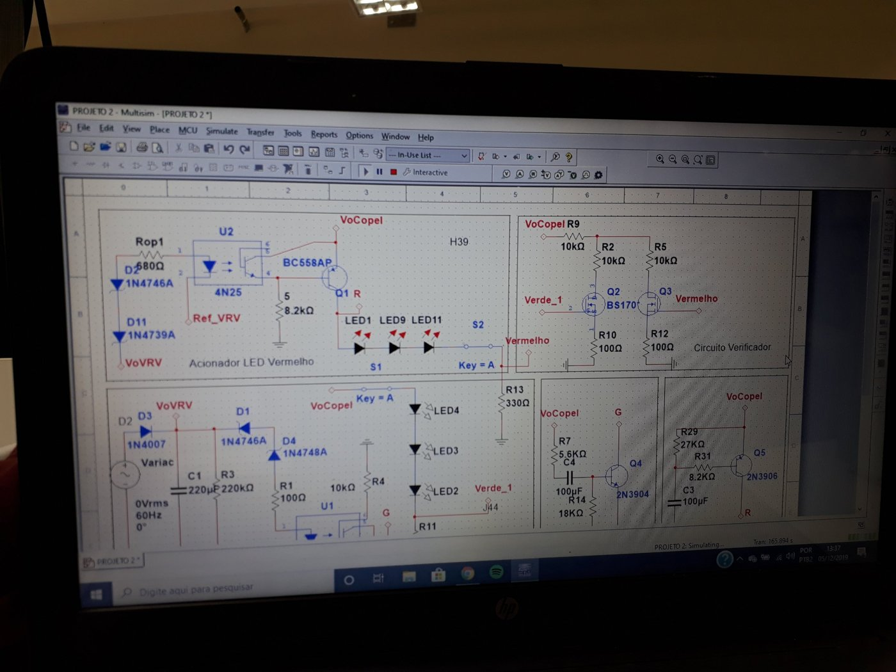
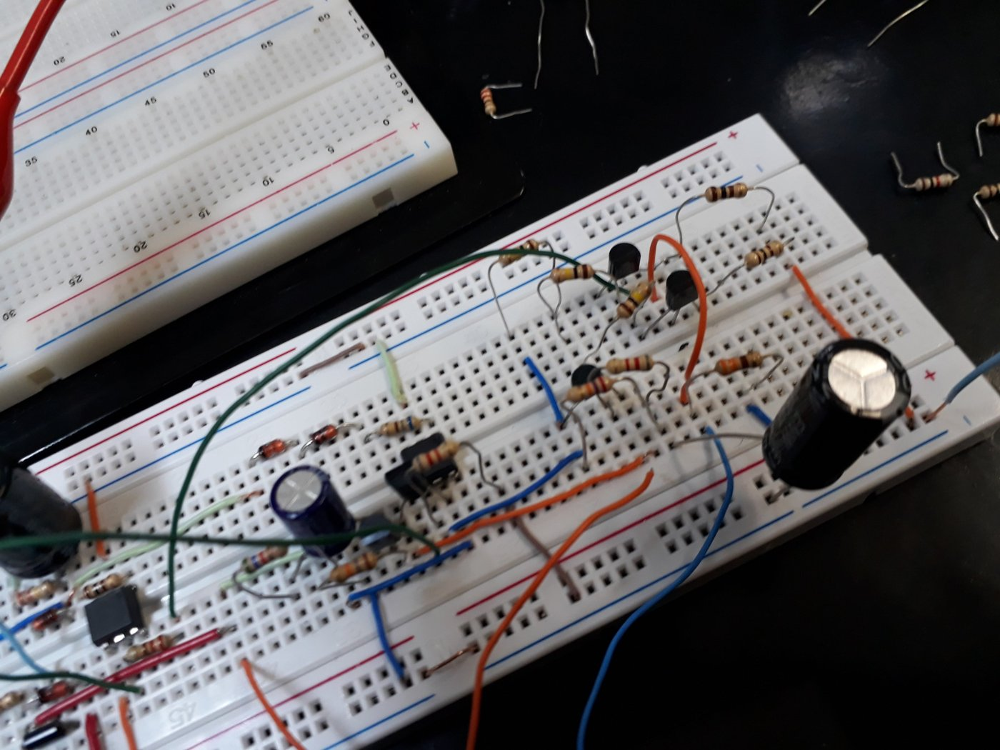
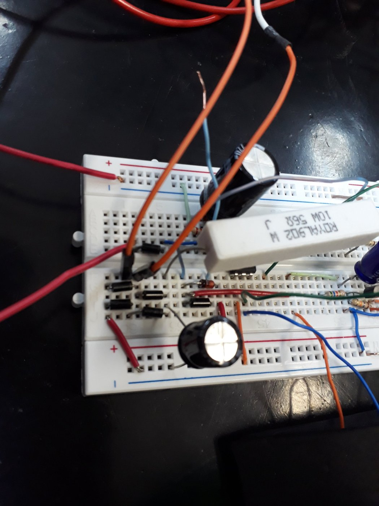

# Doglight, monitor de tensão para aerogeradores

Circuito analógico que monitora a tensão de saída de um aerogerador e sinaliza o estado dele com duas lâmpadas de LED, **verde** para tensão normal e **vermelha** para falha. O circuito tem isolamento galvânico por optoacopladores, alimentação pela rede com bateria de reserva, teste automático das lâmpadas ao ligar e um sinal de diagnóstico de LEDs queimados. Na segunda etapa, a regra era usar só **componentes discretos**, sem amplificador operacional nem outro circuito integrado. Foi um projeto em equipe de três integrantes na disciplina de Eletrônica Analógica I do curso de Engenharia Eletrônica da UTFPR, em 2019.

> **English:** analog wind-turbine voltage monitor built by a three-person team (Analog Electronics I course, UTFPR, 2019). Optocoupler-isolated voltage sensing with Zener thresholds, mains supply with 12 V battery backup, LED-strip lamps, a 3-second lamp self-test at power-up and a DC output that indicates failed LED segments, using discrete transistors only in the second stage.

*Teste no laboratório. Ao ligar, as duas lâmpadas acendem juntas por alguns segundos e depois passam a indicar o estado do gerador, simulado por um autotransformador variável (Varivolt).*

## Requisitos do projeto

| Item | Especificação (equipe 11) |
|---|---|
| Tensão normal do gerador | 42 V de pico (30 Vrms), lâmpada verde |
| Tensão de falha | 28 V de pico (20 Vrms), lâmpada vermelha |
| Alimentação | Rede elétrica, com bateria de 12 V que só assume quando a rede falta |
| Sinalização | Lâmpadas feitas com fita de LED branca, adaptadas para verde e vermelho |
| Diagnóstico | Saída de tensão contínua que muda conforme grupos de 3 LEDs queimam |
| Teste de fábrica | As duas lâmpadas acendem por 3 segundos ao energizar |
| Restrições | Baixo custo para 10 mil unidades e só transistores na segunda etapa |

## Como o circuito funciona

**Fonte com bateria de reserva.** A rede passa por um transformador 10:1, uma ponte de diodos 1N4007 e um capacitor de filtro de 220 µF. Um diodo zener 1N4742A (12 V) regula a tensão do circuito. A bateria de 12 V entra por um diodo 1N4007, de forma que só alimenta o circuito quando a rede cai.

**Leitura do gerador.** Um retificador de meia onda com capacitor transforma a tensão alternada do gerador numa tensão contínua proporcional ao pico.

**Detecção por zeners e isolamento galvânico.** Cada lâmpada tem uma cadeia de diodos zener em série que define o limite de tensão. Só quando a tensão do gerador passa desse limite a corrente acende o LED interno de um optoacoplador **4N25**. Assim o lado do gerador fica eletricamente isolado do lado da sinalização.
- **Verde.** Zeners 1N4746A (18 V) e 1N4748A (22 V) em série, para a tensão normal.
- **Vermelho.** Zeners 1N4746A (18 V) e 1N4739A (9,1 V) em série. Abaixo desse limite o optoacoplador para de conduzir, e um transistor BC558 acende a lâmpada vermelha.

**Lâmpadas de LED.** As lâmpadas usam segmentos da fita de LED branca, com 3 LEDs em série por segmento, dentro de cúpulas verde e vermelha.

**Teste automático ao ligar.** Dois temporizadores RC com transistores, um 2N3904 para a lâmpada verde e um 2N3906 para a vermelha, com capacitores de 100 µF, mantêm as duas lâmpadas acesas por cerca de 3 segundos depois que o circuito é energizado.

**Verificador de LEDs.** Um circuito com MOSFETs BS170 gera uma tensão contínua de saída que muda de valor conforme segmentos de LEDs deixam de funcionar.

## Montagem

| Circuito na protoboard | Fonte de alimentação |
|---|---|
|  |  |

## Arquivos

| Caminho | Conteúdo |
|---|---|
| `simulacao/doglight.ms14` | Circuito completo para simulação no NI Multisim 14 |
| `docs/` | Fotos da montagem, telas da simulação e GIF do teste |

## O que eu faria diferente hoje

- **Placa de circuito impresso.** O circuito foi validado na protoboard. Para um lote de 10 mil unidades, o próximo passo seria uma PCB, que também reduz mau contato e ruído.
- **Ajuste dos limites.** Os limites dependem da tolerância dos zeners, que costuma ser de 5%. Eu acrescentaria um ajuste fino, como um trimpot, para calibrar cada unidade.
- **Três aerogeradores.** O enunciado pedia que o circuito fosse viável para monitorar três geradores. A fonte poderia ser compartilhada, repetindo só o estágio de leitura e os optoacopladores para cada gerador.

---

Projeto desenvolvido em equipe. Repositório mantido por **Isadora Fernanda Zappe Schmidt** · [LinkedIn](https://www.linkedin.com/in/isadora-fernanda)
